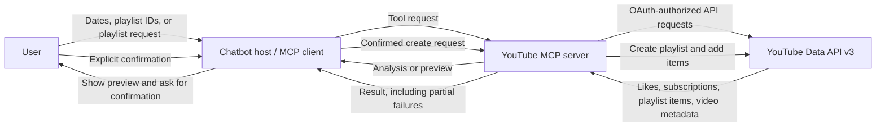
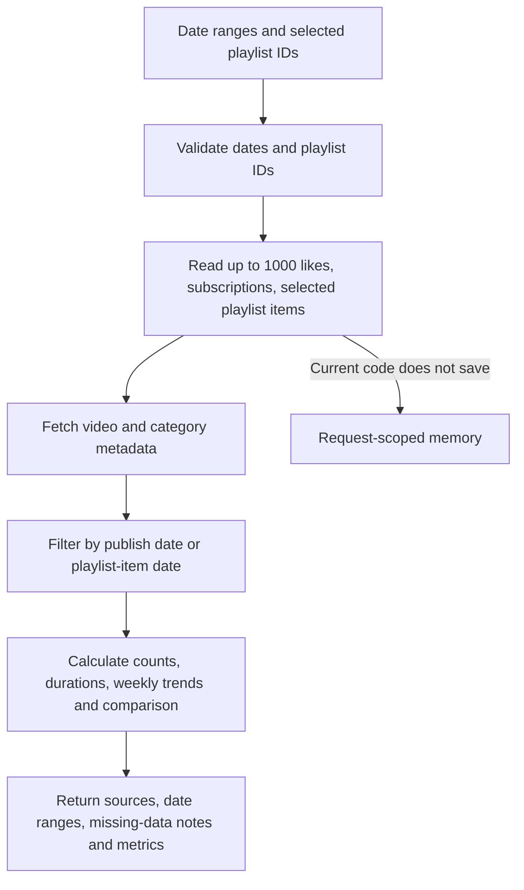
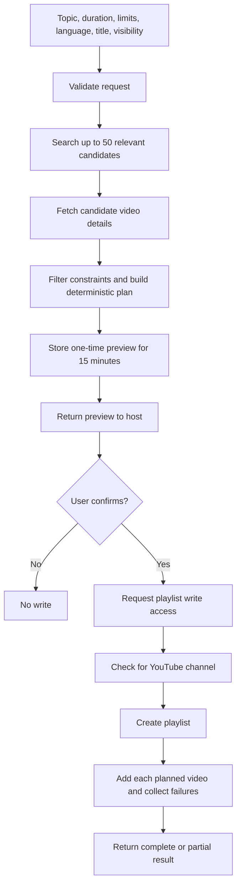
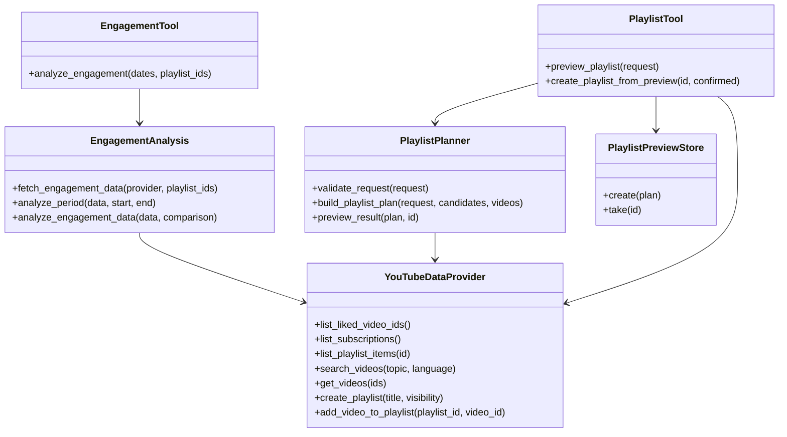
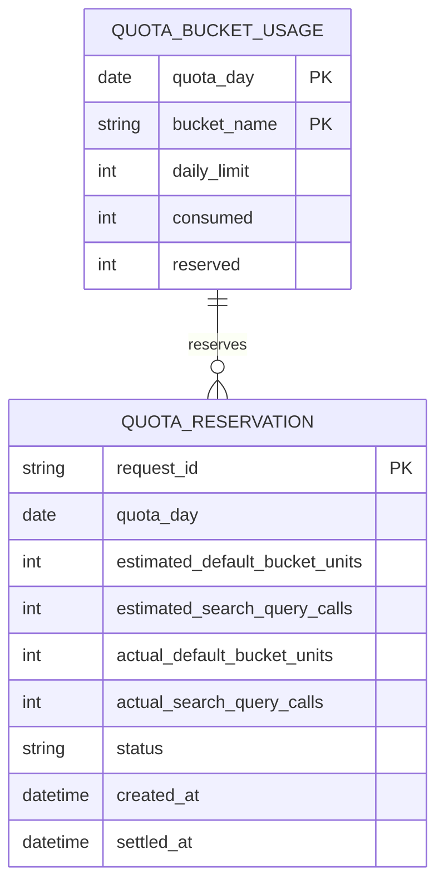

# FR-4 and FR-5 design review

Date: 2026-11-28
Owner: Tharun
Requirements: FR-4.1–FR-4.7, FR-5.1–FR-5.9, NFR-QUOTA-01–03

This note records what the current code does and which choices are settled. The
source code and tests remain the implementation record. Personal project notes
are kept under `brain/tharun/`.

## FR-4 decisions

- Date ranges include the start and end dates.
- YouTube does not return when a video was liked. FR-4 filters liked videos by
  the video publish date and considers up to the latest 1,000 likes returned.
- Subscription trends use the API subscription-created date. Playlist trends
  use the selected playlist item's added date. Dates are treated as the calendar
  date returned by YouTube; no user time zone is applied.
- The report shows weekly trends. It applies the same report metrics to the
  comparison range.
- A video found in both likes and selected playlists counts once in video
  totals. Playlist-item trends count each matching playlist item.
- Results describe liked and saved content, not viewing or watch time. Data is
  read for the request and is not saved.
- FR-4 reads are capped at 1,000 likes, 1,000 subscriptions, five selected
  playlists, 1,000 items per playlist, and 20 pages per source.

## FR-5 decisions

- Search requests one page of up to 50 candidate videos, ordered by YouTube
  relevance. The planner keeps that order.
- Each candidate is checked once. An item is included if its duration fits the
  remaining budget; an exact fit is allowed. A non-fitting candidate is skipped
  and later candidates are still checked.
- Items with unknown duration are skipped. If a language was requested, items
  with unknown or different language are skipped.
- Accepted playlist visibility values are `private`, `unlisted`, and `public`.
- The preview is kept for 15 minutes and can be consumed once. Playlist writes
  start only after explicit confirmation, write access, and a channel check.
  The tool reports which items were added if some inserts fail.
- A manual account check later created the playlist after the user confirmed
  the preview. See [[youtube-mcp]] and [[ai-session-2026-11-26-fr4-fr5-live-check]].

## Data flow — level 0

## Data flow — FR-4

## Data flow — FR-5

## UML — feature classes and boundaries

The provider is an adapter around YouTube API calls. Analysis and planning are
separate from API request construction. The planner is deterministic for the
same request and candidate order. This already gives the FR-4/FR-5 code simple
separation; a broader refactor is not needed for these diagrams. The current
server keeps tool orchestration in one module, so keep future changes small and
move logic only when it reduces duplication or makes quota checks testable.

## ER — existing quota records

FR-4 analytics and FR-5 previews are not stored in the database. The project
currently stores quota reservations, not user analytics. This ER diagram is the existing quota model, also recorded in the [shared architecture note](../../../docs/architecture/architecture.md). The link is enforced in reservation code, not by a database foreign key.

## Patterns and quality review

- **Adapter:** `YouTubeDataProvider` hides YouTube request details from feature
  calculations.
- **Pure calculation/planning:** FR-4 analysis functions and the FR-5 planner
  can be checked with simple input/output tests.
- **Single purpose:** provider calls, date analysis, playlist planning, and
  preview storage have separate modules.
- **Write safety:** the server checks explicit confirmation and uses a one-time
  preview before writes.
- **Quota work added in this review:** FR-4 and FR-5 now reserve a bounded
  estimate before YouTube calls, count actual calls, and settle the reservation.
  FR-4 caps reads at 1,000 likes, 1,000 subscriptions, 1,000 items per playlist,
  five selected playlists, and 20 pages per source. FR-5 reserves one search and details request for
  preview; confirmed creation reserves the channel check and 50 units per write.

## Verification and status

- Full suite after this review: 90 passed, 5 opt-in live checks skipped. Ruff and Brain validation passed.
- FR-4 unit tests: `tests/unit/engagement/` and server tool tests.
- FR-5 unit tests: `tests/unit/playlists/` and
  `tests/unit/test_youtube_playlist_provider.py`.
- Live checks: FR-4 read-only analysis and FR-5 preview worked; the user later
  reported successful playlist creation after confirmation. These account checks
  are not repeated by CI.
- Shared CI already exists at `.github/workflows/ci.yml`; no duplicate workflow
  was added.
- This review is not a release sign-off. PostgreSQL concurrency, a full MCP
  feature integration matrix, and product policy review remain open.

## Stage review

- **Worked:** the main merge was a clean fast-forward; FR-4/FR-5 code and tests
  are present; the preview and confirmed write flow have been manually checked.
- **Did not:** PostgreSQL concurrency and the full MCP feature matrix were not
  checked in this run.
- **Change next:** review the quota wiring and its tests, then begin FR-7.
