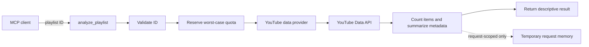
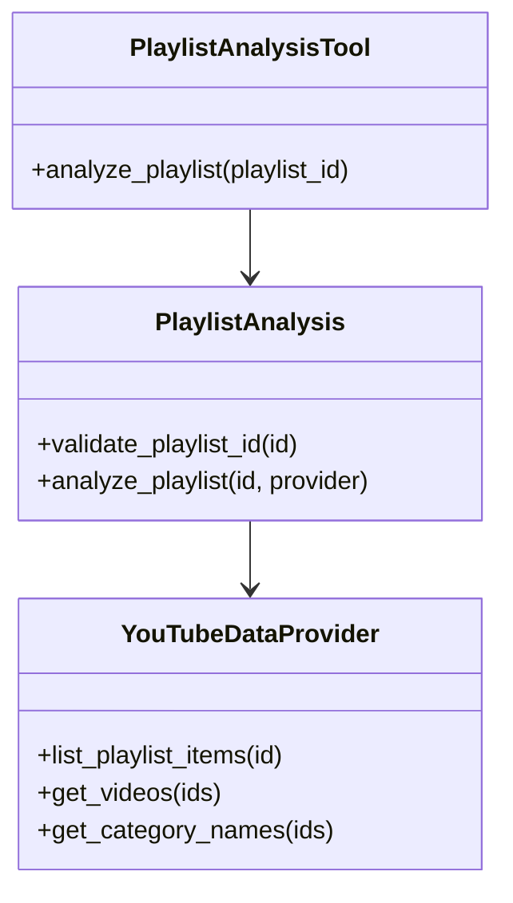
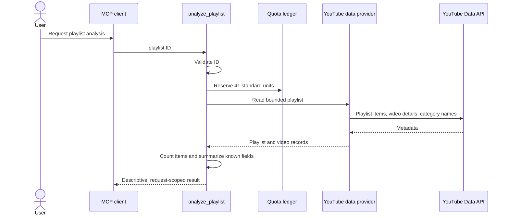

# FR-7 playlist analysis

Date: 2026-11-28
Owner: Tharun
Requirements: FR-7.1–FR-7.6, NFR-QUOTA-01–03, NFR-PRIV-01

## What it does

The `analyze_playlist` tool checks one playlist ID, reserves quota, and reads
playlist items and video metadata through the current YouTube provider. It reads
up to 1,000 items across 20 pages. It returns total known duration, duration
ranges, channel/category counts, and an item summary with links.

Each playlist position counts as an item, including repeated videos. Video
metadata is requested once per unique video ID. Missing videos and durations are
reported. The total uses available durations only and `duration_complete` tells
when information is missing.

The result is descriptive and metadata-based. It does not claim to measure
views, watch time, likes, or viewer behavior. Results are not saved. A YouTube
API policy review is still needed before release or any later storage/expansion.

## Checks

Focused tests: 13 passed. Full suite: 100 passed, 5 live checks skipped.
Ruff, docs/Brain validation, and `git diff --check` passed. The local `python -m build` command was unavailable because `build` is missing
from the host environment. The Docker image rebuilt and packaged the current
code successfully. The live check initially found the old app image;
rebuilding it exposed the tool, and the read-only MCP check then passed. The
playlist result is not saved in project notes.

## Data flow

## Simple class view

## UML sequence

## ER diagram

FR-7 adds no saved analytics records, so there are no new ER entities for this
feature. The project ER diagram remains the quota usage/reservation model in
[[fr4-fr5-design]].

## Next

- Tomorrow: complete the final SRS/SDLC review of FR-4, FR-5, and FR-7.
- Keep analytics request-scoped until the team completes the API policy review.
- Add an issue and PR link when the team creates them; neither ID is available yet.
