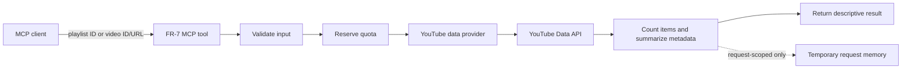
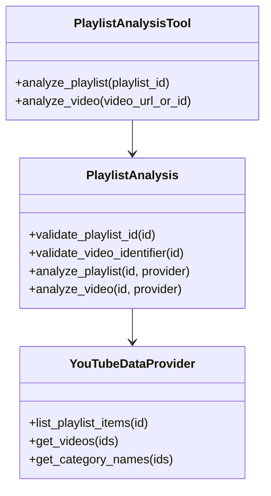
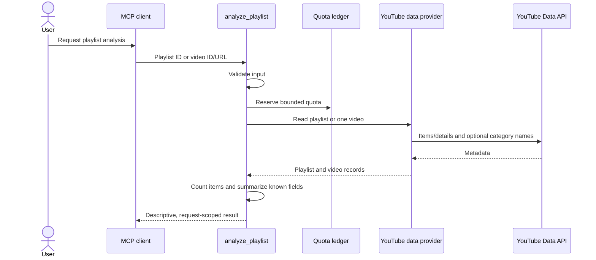

# FR-7 playlist analysis

Date: 2026-11-28
Owner: Tharun
Requirements: FR-7.1–FR-7.6, NFR-QUOTA-01–03, NFR-PRIV-01

## What it does

FR-7 has two read-only tools. `analyze_playlist` checks one playlist ID, reserves
quota, and reads up to 1,000 playlist items across 20 pages. `analyze_video`
checks one video ID or supported URL and reads that video's metadata. Both return
known duration, duration ranges, channel/category counts, and item summaries.

Each playlist position counts as an item, including repeated videos. Video
metadata is requested once per unique video ID. Missing videos and durations are
reported. The total uses available durations only and `duration_complete` tells
when information is missing.

The result is descriptive and metadata-based. It does not claim to measure
views, watch time, likes, or viewer behavior. Results are not saved. A YouTube
API policy review is still needed before release or any later storage/expansion.

## Checks

Focused playlist/video/quota tests: 18 passed. Full suite: 105 passed, 5 opt-in
live tests skipped. Ruff and docs/Brain validation passed. Live FR-4, FR-5 preview,
and FR-7 playlist/video MCP checks passed. The owner confirmed an earlier FR-5
confirmation created a playlist in their account. The final check did not
create another playlist, and live account result data is not saved. `git diff
--check` passed. The local `python -m build` command was unavailable because
`build` is missing from the host environment. The Docker image rebuilt and
packaged the current code successfully. The live check initially found the old
app image; rebuilding it exposed the tool, and the read-only MCP check passed.

## Data flow

## Simple class view

## UML sequence

## ER diagram

FR-7 adds no saved analytics records, so there are no new ER entities for this
feature. The project ER diagram remains the quota usage/reservation model in
[[fr4-fr5-design]].

## Next

- Get the required teammate review on the FR-7 PR, then merge. The YouTube API policy review remains open before storage or release.
- Keep analytics request-scoped until the team completes the API policy review.
- Track this work in [Issue #9](https://github.com/Tharunqi/Yt_MCP/issues/9). Add the PR link after it is opened.
