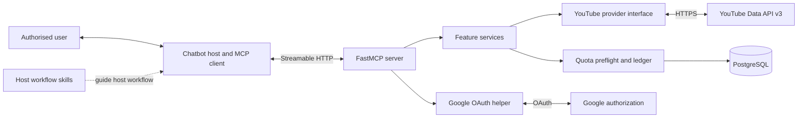
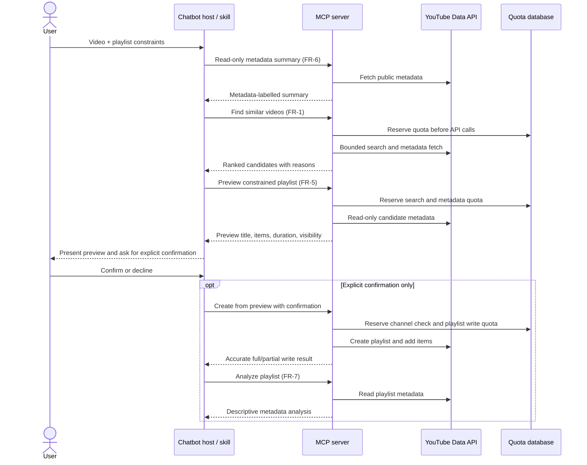
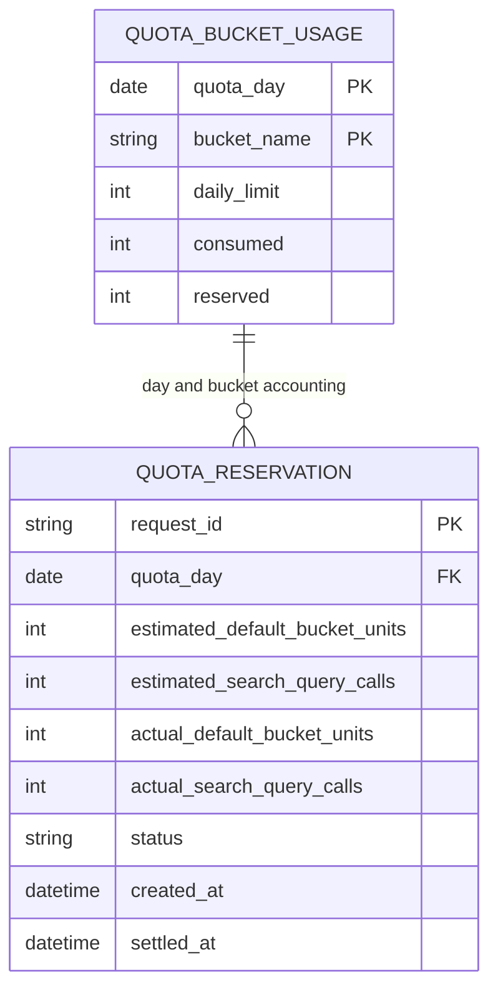

# Architecture and Design

This design describes the current repository boundary and the target product
shape from the [SRS](../requirements/srs.md). Features marked planned are not
claimed as implemented. The implementation reference is [[brain/sid/projects/youtube-mcp-discovery]].

## Component view

Feature code owns validation, ranking, analysis, and planning. API-specific
request construction and error conversion belong behind provider methods.
Skills describe orchestration and consent presentation; server code enforces
validation, quota, and confirmation. OAuth scopes are requested only for the
operation that needs them.

## Current runtime and module allocation

| Concern | Repository location | Status |
|---|---|---|
| MCP entry point and tool registration | `src/youtube_mcp/server.py` | FR-1, FR-4, FR-5, FR-7 tools |
| YouTube API adapters | `src/youtube_mcp/providers/youtube.py` | Shared provider classes |
| Public video and channel discovery | `src/youtube_mcp/discovery/similar_videos.py`, `src/youtube_mcp/discovery/similar_channels.py` | FR-1 and FR-2 implemented with bounded candidate pools |
| Engagement calculations | `src/youtube_mcp/engagement/` | FR-4 present |
| Playlist planning/preview/write | `src/youtube_mcp/playlists/` | FR-5 present |
| Playlist analysis | `src/youtube_mcp/analytics/playlist_analysis.py` | FR-7 present; bounded and request-scoped |
| OAuth helpers | `src/youtube_mcp/auth/` | Used for private data and writes |
| Quota reservations | `src/youtube_mcp/quota/` | SQLAlchemy ledger; preflight for FR-1/2/4/5/6/7; bounded reads; playlist writes cost 50 units each |
| Recommendations and metadata summary | `recommendations/`, `summarization/` | FR-3 incomplete; FR-6 present |

## Video-to-playlist sequence

FR-6 metadata summaries and FR-7 playlist analysis are implemented. The full
SK-1 host-to-tool end-to-end workflow still needs a product check.

## Quota data model (implemented records)

The SQLAlchemy schema currently defines daily bucket usage and per-request
reservations. The logical relation is enforced in reservation/settlement logic;
the model does not declare a direct relational foreign key. User preferences
and OAuth credentials are not represented in this current schema. Migrations
are deferred; `Base.metadata.create_all` only creates missing tables.

## Deployment and trust boundaries

Docker Compose runs the MCP app and PostgreSQL on a private compose network. The
MCP process listens on the container interface; Compose publishes port 8000 on
host loopback only (`127.0.0.1:8000`). YouTube and Google OAuth are external
HTTPS boundaries. API responses are untrusted data. Secrets are supplied
through the runtime environment or protected local OAuth files, never embedded
in source, images, Brain notes, fixtures, or logs. Remote deployment needs a
separate authentication, TLS, and Origin/host review.

Open design decisions are recorded in the [SRS](../requirements/srs.md) and
[development plan](../development-plan.md).
